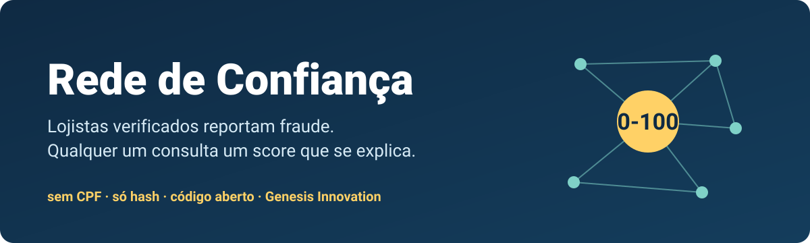
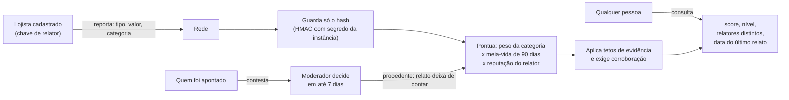
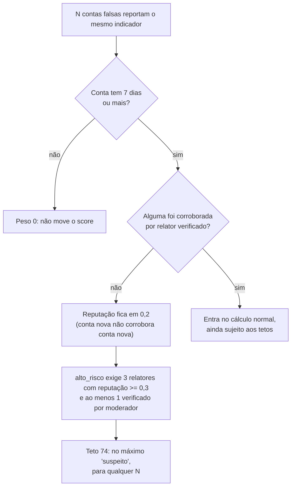

<div align="center">



# Rede de Confiança

**Fraude que um lojista descobre sozinho, a rede descobre junto.**

[](LICENSE)
[](https://nodejs.org)


[Em 30 segundos](#em-30-segundos) ·
[Como o score funciona](#como-o-score-funciona) ·
[Como colaborar](#como-colaborar) ·
[English](README.en.md)

</div>

Uma rede aberta onde **lojistas cadastrados reportam fraude** (chargeback, cartão
testado, conta falsa, phishing, bot) por **IP, e-mail, domínio ou dispositivo**,
e **qualquer pessoa consulta** um score de 0 a 100 com regras públicas e testadas.
Iniciativa da [Genesis Innovation](https://genesisinnovation.io), código aberto.

## Por que existe

Quem vende online sabe como termina: o pedido parece normal, a mercadoria sai, e
semanas depois chega o chargeback. Você perde o produto, o frete e costuma
ainda pagar taxa. O mesmo fraudador, com o mesmo e-mail ou a mesma rede, tenta a loja do lado.

Quem é grande costuma ter equipe e ferramenta própria para isso. A loja pequena
descobre sozinha, uma de cada vez, e cada uma paga o mesmo aprendizado caro. A informação
que evitaria o segundo golpe existe; ela só está trancada em cada caixa de
e-mail.

A Rede de Confiança é o lugar comum onde essa informação entra e sai, com três
cuidados que a tornam usável de verdade: **quem reporta precisa ser cadastrado**,
**o dado é guardado só como hash** e **o score se explica por regras que qualquer
um pode ler e discutir**.

## Como funciona



A consulta é aberta e nunca lista relatos nem relatores. Reportar exige chave,
que um moderador avalia e entrega.

### Defesa contra conluio

O ataque óbvio a uma rede aberta é criar muitas contas falsas para derrubar o
score de um concorrente. As regras foram feitas para que isso, por
construção, não chegue ao nível mais alto:



Essa garantia (N contas falsas sem verificado nunca passam de `suspeito`) tem
teste: ver `tests/pontuacao.test.mjs` e `tests/redteam.test.mjs`.

## Como o score funciona

Cada relato pesa **peso da categoria x decaimento no tempo x reputação do relator**.
A soma é saturante: `score = round(100 * (1 - exp(-soma / 1.5)))`. A função é pura
e determinística (`src/pontuacao.js`), e cada regra abaixo tem teste. A
especificação completa é o [contrato técnico](docs/CONTRATO.md).

| Regra | Valor |
|---|---|
| Peso base por categoria | `chargeback` 1,0 · `cartao_testado` 0,9 · `phishing` 0,8 · `conta_falsa` 0,6 · `bot_abuso` 0,5 · `outro` 0,2 |
| Meia-vida | O peso do relato cai pela metade a cada **90 dias**. Depois de 24 meses o relato é apagado |
| Um relator, uma categoria | Repetir o mesmo relato não soma; vale o de maior peso |
| Conta nova | Menos de **7 dias** de conta: peso **0** (aparece na contagem de relatores, mas não move o score) |
| Reputação do relator | Começa em **0,2**. Só passa de 0,3 depois de corroborada por um relator **verificado** (ou por alguém que um verificado corroborou). Relator novo e não verificado não corrobora ninguém |
| Teto com poucas fontes | 1 relator efetivo: no máximo **24**. 2 relatores: no máximo **49** |
| Verificado | `alto_risco` (score a partir de 75) exige **3 relatores** com reputação de 0,3 ou mais, dos quais **ao menos 1 verificado por um moderador**. Sem isso o teto é **74**. Para IP exige ainda 5 relatores efetivos (IP compartilhado, CGNAT e VPN são sinal fraco) |
| Níveis | `desconhecido` abaixo de 25 · `suspeito` de 25 a 74 · `alto_risco` de 75 |
| Contestação | Só a decisão `procedente` de um moderador derruba relatos. Contestação aberta não muda o score (senão contestar seria arma contra relato verdadeiro) |

Hoje a resposta HTTP da consulta traz `score`, `nivel`, `relatores_distintos` e
`ultimo_relato_em`. A função `pontuar()` também gera a lista de `motivos`, mas a
rota **ainda não a devolve** (de propósito, a resposta é uma lista branca);
expô-la está no [roadmap](#roadmap).

## Em 30 segundos

Consultar (qualquer um, sem chave):

```sh
curl -X POST https://SUA-INSTANCIA/v1/consulta \
  -H "Content-Type: application/json" \
  -d '{"tipo":"email","valor":"fulano@exemplo.com"}'
# { "score": 12, "nivel": "desconhecido", "relatores_distintos": 1, "ultimo_relato_em": 1760000000000 }
```

Reportar (lojista com chave de relator):

```sh
curl -X POST https://SUA-INSTANCIA/v1/relatos \
  -H "Authorization: Bearer $CHAVE_DE_RELATOR" \
  -H "Content-Type: application/json" \
  -d '{"tipo":"ip","valor":"203.0.113.7","categoria":"cartao_testado","evidencia":"12 tentativas em 3 min"}'
# 201 { "id": "..." }
```

> Ainda **não há instância de referência no ar**: `SUA-INSTANCIA` é a sua (veja
> [Rodar local](#rodar-local)) ou a de quem for operar uma. Está no
> [roadmap](#roadmap).

Detalhes que vale saber:

- Tipos de indicador: `ip`, `email`, `dominio`, `dispositivo`. O valor cru **não vai
  na URL** (`GET /v1/consulta?valor=` não existe): URL cai em log de borda e de proxy.
- Categorias: `chargeback`, `cartao_testado`, `conta_falsa`, `phishing`, `bot_abuso`, `outro`.
- A `evidencia` (até 280 caracteres) nunca é devolvida em rota pública. **Não coloque
  dado pessoal nela:** sequência que pareça CPF ou cartão é recusada
  (`400 dado_pessoal`).
- Limite de consulta: 300 por minuto por balde de rede (IPv4 `/24`, IPv6 `/64`).
- Um relato só pesa depois de 7 dias de conta do relator.

### Consultar sem enviar o valor (hash no cliente)

O hash é `sha256("rdc:v1:" + tipo + ":" + normalizado)`, em hexadecimal minúsculo
(64 caracteres). Calcule na sua máquina e envie só o hash.

Em Node (normaliza como a rede normaliza: minúsculas, `+tag`, pontos do Gmail,
punycode, IPv6 em /64):

```js
import { hashIndicador } from "./src/normalizar.js";

const hash = hashIndicador("email", "Fulano+promo@Exemplo.com"); // 64 hex
const r = await fetch("https://SUA-INSTANCIA/v1/consulta", {
  method: "POST",
  headers: { "content-type": "application/json" },
  body: JSON.stringify({ tipo: "email", hash }),
});
console.log(await r.json());
```

Em shell, **só se o valor já estiver normalizado** (e-mail em minúsculas, sem
`+tag`; o shell não normaliza por você, e valor mal normalizado dá hash que a
rede não conhece):

```sh
hash=$(printf '%s' "rdc:v1:email:fulano@exemplo.com" | sha256sum | cut -d' ' -f1)
curl "https://SUA-INSTANCIA/v1/consulta?tipo=email&hash=$hash"
```

Esse é o hash **público**. O servidor não o grava como veio: guarda
`HMAC-SHA256(PEPPER, hash)`, com um segredo que só o operador tem, então um banco
vazado não se reverte por força bruta. Mesmo assim, hash de e-mail ou IP comum é
pseudonimização, não anonimato. Por isso a rede não exporta hashes.

### Contestar

Se um indicador seu foi apontado por engano, qualquer pessoa pode contestar:

```sh
curl -X POST https://SUA-INSTANCIA/v1/contestacoes \
  -H "Content-Type: application/json" \
  -d '{"tipo":"dominio","valor":"minhaloja.com.br","motivo":"Domínio comprado em 2024, sem relação com o caso.","contato":"eu@minhaloja.com.br"}'
# 201 { "id": "..." }
```

Aceita `{"tipo":"dominio","hash":"..."}` no lugar de `valor`. A decisão sai em até
7 dias; veja [docs/MODERACAO.md](docs/MODERACAO.md).

### Pedir uma chave de relator

```sh
curl -X POST https://SUA-INSTANCIA/v1/relatores/solicitacoes \
  -H "Content-Type: application/json" \
  -d '{"nome":"Minha Loja","contato":"eu@minhaloja.com.br","loja_url":"https://minhaloja.com.br"}'
# 201 { "id": "..." }  (um moderador avalia; limite de 3 pedidos por hora por balde de rede)
```

## O que NÃO é

- **Não é lista de culpados.** Indicador não é pessoa. Um IP pode ser de uma rede
  compartilhada; um e-mail pode ter sido roubado.
- **Nunca é prova.** O score é pista para decidir, não sentença.
- **Nunca é bloqueio automático.** Quem consulta decide; recomendamos revisão
  humana antes de qualquer recusa. Quem for afetado pode contestar
  ([docs/MODERACAO.md](docs/MODERACAO.md)).
- **Não guarda CPF**, número de cartão nem dado de pagamento, em hipótese alguma.
- **Não é um firewall nem um antifraude pronto.** É uma fonte de sinal para o
  seu antifraude, ou para a sua análise manual.

## Privacidade em 5 linhas

1. O valor cru (IP, e-mail, domínio, dispositivo) **nunca é gravado**: o servidor guarda um HMAC do hash, com segredo que não está no banco.
2. O IP de quem consulta **nunca é guardado**; só um HMAC do bloco de rede, nos contadores de limite, apagados todo dia.
3. CPF e número de cartão são **recusados na entrada** (`400 dado_pessoal`); a evidência é privada e só moderador lê.
4. Relato some em **24 meses**; dados de contato de quem pediu ou perdeu a chave, em **90 dias**.
5. Hash é pseudonimização, não anonimato: por isso **não existe exportação em massa**.

Detalhes, limites e a base legal (ainda a validar com advogado):
[docs/PRIVACIDADE.md](docs/PRIVACIDADE.md).

## Como se compara

Não somos substitutos de ninguém. São ferramentas boas para problemas vizinhos:

| | **Rede de Confiança** | **AbuseIPDB** | **CrowdSec** |
|---|---|---|---|
| Foco | Fraude de comércio: chargeback, cartão testado, conta falsa | Reputação de IPs que atacam (abuso, varredura, spam) | Detecção de comportamento malicioso em servidores e compartilhamento de IPs atacantes |
| Indicadores | IP, e-mail, domínio, dispositivo | Principalmente IP | Principalmente IP |
| Quem reporta | Lojistas **cadastrados**, com reputação e verificação por moderador | Usuários registrados | Instalações do agente |
| Score | Explicável por regras escritas e testadas aqui | Conforme a documentação deles | Conforme a documentação deles |
| Serviço público já no ar | **Ainda não** (ver roadmap) | Sim | Sim |

Se o seu problema é ataque de rede ao seu servidor, comece por eles. Se o problema
é pedido fraudulento no checkout, a lacuna que esta rede tenta cobrir é outra: o
mesmo e-mail, domínio ou dispositivo reaparecendo de loja em loja. Funciona bem
**junto** deles. As colunas deles são um resumo do que sabemos;
confirme na documentação de cada um, que pode ter mudado.

## Rodar local

O serviço é um Worker Cloudflare com banco D1. Node 22, sem dependências npm. Com
`wrangler` instalado:

```sh
npx wrangler d1 create rede-de-confianca            # copie o database_id para o wrangler.toml
npx wrangler d1 migrations apply rede-de-confianca --local   # aplica schema/001 e 002 em ordem
npx wrangler secret put ADMIN_TOKEN                 # 32+ caracteres; ou use .dev.vars no desenvolvimento local
npx wrangler secret put PEPPER                      # 32+ caracteres aleatórios; sem ele o Worker responde 500 `configuracao`
npx wrangler dev
```

Gere os dois com `openssl rand -hex 32`. **Guarde o `PEPPER` num cofre:** os hashes
gravados dependem dele, e trocá-lo zera a rede (nenhum relato antigo casa mais).
Depois, `curl http://localhost:8787/v1/saude` deve responder `{"ok":true,"versao":"1"}`.

Rodar os testes:

```sh
node --test
```

(Sem `tests/` no fim: no Node 22 `node --test tests/` trata a pasta como módulo e
falha.) A suíte usa um D1 falso sobre `node:sqlite`; ver o roadmap sobre D1 real.

## Roadmap

O que existe: regras de score, API, moderação, contestação, expiração e limites,
com testes. O que **ainda falta**, sem maquiagem:

- [ ] Ligar o CI: o workflow está pronto em `.github/ci-pendente/ci.yml`; falta movê-lo para `.github/workflows/` (o token que publicou o repo não tinha o escopo `workflow`)
- [ ] Instância de referência no ar, operada pela Genesis
- [ ] SDK de cliente (normalizar, hashear, consultar e reportar sem montar curl)
- [ ] Plugin para plataformas de loja (consulta no checkout)
- [ ] Rota para apagar `contato` e `motivo` de uma contestação a pedido (hoje é manual, direto no banco)
- [ ] Corrida no dedupe de 30 dias: a checagem de relato repetido e a gravação não são atômicas
- [ ] Revogação em massa: desativar de uma vez todos os relatos de um relator malicioso
- [ ] Validação contra um D1 real (a suíte hoje roda num D1 falso)
- [ ] Decidir se a consulta devolve a lista de `motivos` que o score já calcula
- [ ] Revisão jurídica da base legal (LGPD) e do papel de controlador entre instâncias

Quer pegar um item? Abra uma issue com o modelo `proposta`.

## Como colaborar

A rede só vale se muita gente entrar. Há um lugar para cada perfil:

- **Sou lojista.** Peça uma chave de relator ([como pedir](#pedir-uma-chave-de-relator)).
  Quanto mais lojas independentes reportam, mais o score fica confiável.
- **Sou dev.** Abra uma issue ou um PR pequeno, com teste que falha sem a mudança.
  Rode `node --test` e leia o [CONTRIBUTING.md](CONTRIBUTING.md). Os itens do
  [roadmap](#roadmap) são um bom começo.
- **Quero moderar.** A moderação precisa de gente de confiança: veja
  [docs/MODERACAO.md](docs/MODERACAO.md) e a [governança](docs/GOVERNANCA.md).
- **Sou da área jurídica ou de proteção de dados.** Revise
  [docs/PRIVACIDADE.md](docs/PRIVACIDADE.md); a base legal ainda está marcada como
  "a validar com advogado".
- **Quero rodar a minha própria instância.** É permitido e incentivado; veja
  [Rodar local](#rodar-local).
- **Tenho uma ideia ou quero trocar.** Fale direto com o Thiago, da Genesis, no
  WhatsApp: <https://wa.me/5521995988404?text=Oi!%20Vim%20pelo%20reposit%C3%B3rio%20da%20Rede%20de%20Confian%C3%A7a%20e%20quero%20trocar%20ideias.>
  Ideia boa vira issue pública, para ficar registrada para todo mundo.

Leia também o [código de conduta](CODE_OF_CONDUCT.md). Mudança nas regras de score
segue o rito da [governança](docs/GOVERNANCA.md) (7 dias de comentários).
Vulnerabilidade não vai em issue pública: [SECURITY.md](SECURITY.md).

## FAQ

**Por que não CPF?**
Porque a rede não precisa dele para o que faz, e quanto menos dado pessoal,
menos dano se algo vazar. O sinal vem de IP, e-mail, domínio e dispositivo, e CPF
é recusado na entrada.

**Posso rodar minha própria instância?**
Pode e é incentivado: a licença permite, e o serviço roda no seu Cloudflare
([Rodar local](#rodar-local)). Cada instância tem o seu operador, que responde por
ela; [docs/PRIVACIDADE.md](docs/PRIVACIDADE.md) é o padrão mínimo recomendado.
Cada instância tem a sua própria base; o código não implementa troca de dados
entre instâncias.

**Posso ser bloqueado sem saber?**
A rede em si não bloqueia ninguém: ela devolve um número, e quem consulta decide.
Uma loja pode, sim, recusar um pedido seu com base nele, e a rede não tem como
avisar você, porque não guarda contato de quem é consultado. O que você pode fazer:
consultar o seu próprio e-mail, domínio ou IP, e, se estiver apontado por engano,
[contestar](#contestar). Por isso a recomendação é sempre revisão humana antes de
recusar.

## Documentos

- [Contrato técnico](docs/CONTRATO.md)
- [Privacidade e LGPD](docs/PRIVACIDADE.md)
- [Moderação e contestação](docs/MODERACAO.md)
- [Governança](docs/GOVERNANCA.md)
- [Segurança](SECURITY.md)
- [Como contribuir](CONTRIBUTING.md)

## Licença

- **Código** (`src/`, `tests/`, `schema/`, `wrangler.toml`): [Apache License 2.0](LICENSE).
- **Documentação** (`docs/` e este README): [CC0 1.0](LICENSE-DOCS), domínio público.
  As regras de uma rede de confiança são um bem comum; copie, adapte e rode a sua.

Copyright 2026 Genesis Innovation (ver [NOTICE](NOTICE)).

## Contato

Ideias e dúvidas: issue pública ou o WhatsApp acima. Vulnerabilidade:
[SECURITY.md](SECURITY.md). Privacidade e conduta: endereços em
[docs/PRIVACIDADE.md](docs/PRIVACIDADE.md) e no [código de conduta](CODE_OF_CONDUCT.md).

## Agradecimentos

A quem já passou por chargeback e transformou a irritação em regra clara, e a
quem revisa, testa e questiona o score: é isso que o mantém justo. Obrigado
também aos projetos abertos em que esta rede se apoia: Cloudflare Workers e D1,
e o Node.js.
